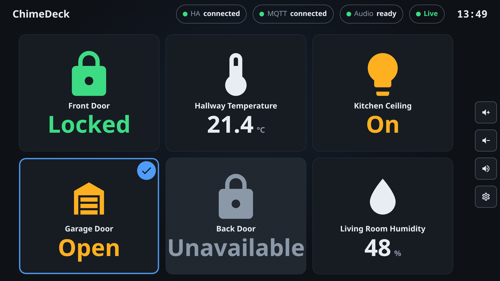
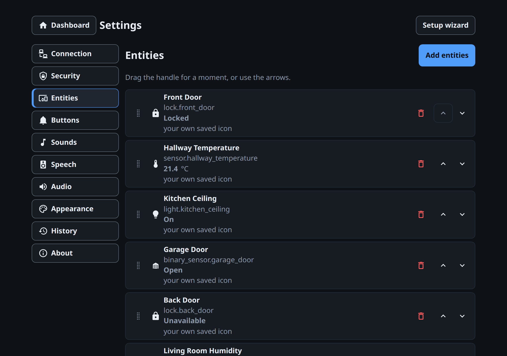

# ChimeDeck

**Your house already knows what is happening. ChimeDeck is the thing that tells you — out loud,
in the room you are standing in.**

A small self-hosted panel for [Home Assistant](https://www.home-assistant.io/): a wall display that
shows the handful of things you actually care about, and a speaker Home Assistant can ring for *any*
event — the doorbell, the laundry finishing, the garage left open at night.



Live states over the Home Assistant websocket. The rail on the right is volume and settings; the
blue outline and tick on **Garage Door** is that tile *selected* — which Home Assistant can see.

|  |  |
| --- | --- |
| **Runs on** | any 64-bit Linux box — a Raspberry Pi, an old NUC, a thin client |
| **Needs** | Python 3.11+, a Home Assistant token, an MQTT broker you already run |
| **Does not need** | cloud, an account, a subscription, or a beefy CPU |
| **Ships with** | systemd user units, a kiosk wrapper, Docker images, 2,600+ backend tests, 1,000+ frontend tests, 97 browser tests |

---

## Contents

- [Why you would want this](#why-you-would-want-this)
- [What it does](#what-it-does)
- [Point at it, and let Home Assistant do the thinking](#point-at-it-and-let-home-assistant-do-the-thinking)
- [Install](#install)
- [Speech, without the subscription](#speech-without-the-subscription)
- [How it fits together](#how-it-fits-together)
- [Two listeners, and why that matters](#two-listeners-and-why-that-matters)
- [Is it true? What the tests actually prove](#is-it-true-what-the-tests-actually-prove)
- [Documentation](#documentation)
- [Status](#status)

---

## Why you would want this

A doorbell chime is a single-purpose thing: it makes one noise for one event, for one vendor. Home
Assistant already knows about every event in the house — the dryer, the gate, the freezer door, the
front door — so the only missing part is something in the hallway that can *speak*.

ChimeDeck is that something, and it deliberately knows nothing about your rules. It shows what you
tell it to show, and it plays what you tell it to play. **The policy lives in Home Assistant**, where
you can already write it, version it, and undo it.

---

## What it does

- **Big, glanceable tiles.** Any Home Assistant entity, with its icon, name and current state, big
  enough to read from across a room. Numeric entities get units, unavailable entities say so instead
  of going blank, and every state is a *word*, never colour alone.
- **Buttons that play sounds or speak.** Each chime appears in Home Assistant as a real device
  button. Press it from an automation, a dashboard, a physical button — the box plays the sound, or
  says the sentence, on its own speaker.
- **Live values in speech.** *"The garage door is still open"* with the actual state read through
  Home Assistant's own templates, at the moment of the press.
- **Quiet hours.** No 3am chimes, with per-button exceptions for things that genuinely matter.
- **A press history.** Every press logged with what played, how long it took and whether it was
  suppressed — because "did the doorbell actually ring?" should have an answer.
- **Volume that does not lie.** Software gain and the device's own hardware level are separate
  sliders, both defaulting to 100, and the panel reports the level the hardware actually reached.
- **Fits the screen you own.** The layout fills whatever resolution and aspect ratio the panel
  offers, and an interface-scale setting grows the whole UI for a high-DPI display whose mode you
  cannot change.
- **No cloud, no account.** It talks to your Home Assistant and your MQTT broker. Nothing else.

---

## Point at it, and let Home Assistant do the thinking

Tapping a tile does not open a menu, and it does not do anything in ChimeDeck. It publishes an MQTT
`switch` — *"this is the thing I care about right now"* — which Home Assistant can watch, act on, and
clear again.

That one primitive covers the workflow people actually want. Tap **Dryer** when you load it; when
the load finishes, Home Assistant rings a chime and turns the tile off again:

```yaml
automation:
  - alias: "Dryer finished — chime, then clear the tile"
    triggers:
      - trigger: state
        entity_id: switch.chime_deck_dryer
        to: "on"
    actions:
      - action: button.press
        target:
          entity_id: button.chime_deck_dryer_done
      - action: switch.turn_off
        target:
          entity_id: switch.chime_deck_dryer
```

No doorbell-side logic, no second place to keep rules in sync. Rename the panel, move the tiles
around, re-flash it — the automation does not change.

---

## Install

```bash
git clone https://github.com/insanemal/chime-deck
cd chime-deck
sudo apt install libmpv2 libportaudio2 ffmpeg espeak-ng   # Debian / Raspberry Pi OS
uv sync
uv run chime-deck
```

That is the whole development loop: the server comes up on `http://127.0.0.1:8080`. Open the admin
listener on `:8081` from your phone or laptop, and the first-run wizard asks for your Home Assistant
URL and token and your MQTT broker. Nothing needs a config file.

<p align="center">
  
</p>

For the real thing — systemd **user** units, `loginctl enable-linger`, upgrades and backups — see
[`docs/installing.md`](docs/installing.md). For a panel on a wall, [`docs/kiosk.md`](docs/kiosk.md)
covers the Chromium wrapper, seat and DRM problems, pinning a display mode, and the case where the
mode cannot be changed at all.

Docker works too: the multi-stage `Dockerfile` and `deploy/docker-compose.yml` ship, and the release
workflow publishes `amd64` + `arm64` images on a `v*` tag. The native install is still the
recommended path, because audio passthrough and the kiosk browser are inherently host-shaped.

---

## Speech, without the subscription

The panel can generate its own voice, borrow Home Assistant's, or ask a bigger machine. What it will
never do is make you depend on a vendor to hear your own doorbell.

| Engine | Runs where | Needs |
| --- | --- | --- |
| `espeak_ng` | the panel | ~2 MB, robotic but instant |
| `ha_tts` | your Home Assistant | nothing on the panel |
| `remote_tts` | another Linux box | a token, one command to start |
| `http_tts` | a cloud provider | an API key; paid providers bill per character |
| `piper` | the panel | ~2 GB RAM, natural-sounding, offline |

**Speech that costs nothing to repeat.** A phrase with no live values is rendered to audio **once**
and reused forever, so pressing the button a thousand times makes one TTS request — cloud quotas
last, and a press is as fast as a local file. Only phrases containing live state are re-rendered per
press, and the UI warns you when a phrase falls into that category.

A 1 GB panel is therefore a perfectly good doorbell: it only has to *play* audio, never generate it.

---

## How it fits together

```
                        ┌───────────────────────────────────────┐
                        │               ChimeDeck               │
   Home Assistant       │                                       │
   ┌───────────────┐    │   ┌─────────────────────────────┐     │
   │ automation:   │───▶│   │ MQTT bridge   ── chime press │     │
   │ button.press  │    │   └──────────────┬──────────────┘     │
   └───────────────┘    │                  ▼                    │
   ┌───────────────┐    │   ┌─────────────────────────────┐     │
   │ states ◀────▶ │◀──▶│   │ audio engine → 🔊 speaker   │     │
   │ switch (tap)  │    │   └─────────────────────────────┘     │
   └───────────────┘    │   ┌─────────────────────────────┐     │
                        │   │ web UI ── kiosk on the wall  │     │
                        │   └─────────────────────────────┘     │
                        └───────────────────────────────────────┘
```

One Python process serves the dashboard, holds the Home Assistant websocket, owns the MQTT
connection and drives the audio engine. The browser is a renderer, not an audio path — the sound
always comes out of the box itself, which is the one thing that never moves elsewhere.

---

## Two listeners, and why that matters

| Listener | Default | Serves |
| --- | --- | --- |
| app | `127.0.0.1:8080` | everything: the dashboard, the API, the live websocket |
| admin | `0.0.0.0:8081` | configuration only — `/` redirects to `/settings` |

The dashboard is deliberately **loopback-only and unauthenticated**, because a wall display cannot
log in — so it must never be reachable from the network. The admin listener is the one you open from
a phone or laptop, and it takes a password. If someone hands you a screenshot of a ChimeDeck
dashboard on the LAN, something is misconfigured.

---

## Is it true? What the tests actually prove

Five tiers, and every result says which one it came from:

| Tier | Command | Proves |
| --- | --- | --- |
| Unit | `uv run pytest -q` | logic, parsing and error paths — fully stubbed, offline, seconds |
| Integration | `./scripts/test-integration.sh` | real `espeak-ng`, real `libmpv`, real `ffmpeg` in a container |
| aarch64 | `./scripts/test-integration.sh --board` | the same on the target architecture |
| Frontend | `cd web && npm run verify` | types, WCAG contrast in both themes, component tests, and that the committed bundle is byte-identical to a fresh build |
| Browser | `cd web && npm run test:browser` | the real UI in a real browser against the **real backend** — taps, the rail, settings, live state |

Two honest limits, stated rather than glossed: a container plays to a null sink, so "it played" there
means "it decoded and played", never "it was heard"; and the aarch64 board plays to real hardware,
but only a person in the room can confirm it was audible. That is why audible acceptance is a
separate, owner-assisted pass rather than a test. The full reference is
`Project_state/design/07-testing.md`.

---

## Documentation

| | |
| --- | --- |
| [installing.md](docs/installing.md) | packages, the systemd user unit, upgrades, backups, Docker |
| [home-assistant.md](docs/home-assistant.md) | entities, the selection switch contract, automations, troubleshooting |
| [kiosk.md](docs/kiosk.md) | the display: seat and DRM problems, pinning a mode, interface scale |
| [releasing.md](docs/releasing.md) | what a `v*` tag builds and publishes |

If you want to work on it:

| Path | What |
| --- | --- |
| `src/chime_deck/` | the Python backend: FastAPI, MQTT bridge, audio engine, TTS |
| `web/` | the Svelte 5 frontend; the built bundle in `web/dist` is committed, so a clone needs no Node.js to run |
| `tests/` | the pytest suite |
| `deploy/` | systemd user units, the kiosk wrapper, the compose file |
| `data/` | runtime state: database, sounds, icons, TTS cache *(git-ignored)* |

---

## Status

**Working, and in daily use.** Everything above is implemented, tested and running on a real panel:
tiles, selection switches, chime buttons, MQTT discovery, the Home Assistant REST and websocket
clients, the audio engine, five TTS engines, quiet hours, the dashboard and settings UI, the setup
wizard, systemd units, the kiosk wrapper and the Docker build.

What is left on the backlog is an all-in-one flashable image with first-boot Wi-Fi provisioning, and
polish. Not missing functionality.

---

## Licence

The project's own code is MIT — see [LICENSE](LICENSE).

The Docker images bundle third-party copyleft binaries on top of it, and their
`org.opencontainers.image.licenses` label says so: `MIT AND LGPL-2.1-or-later AND GPL-2.0-or-later AND
GPL-3.0-or-later`. `espeak-ng` (GPL-3.0-or-later), `libmpv2` and `ffmpeg` come from the Debian base
image in *both* tags, so "MIT-only image" would be false of either.

What the separate `:piper` tag exists for is the optional local Piper TTS engine (`piper-tts`,
GPL-3.0-or-later), which is never bundled in a default install: it is an opt-in extra
(`uv sync --extra piper`) or that second tag. Neither tag bakes a voice model — voice models are
licensed separately, the licence varies per voice, and the app downloads the one you choose, showing
its licence in the Speech panel.

Bundled demo sounds are CC0/public domain, with sources recorded alongside them.
